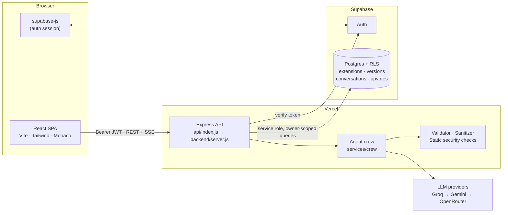
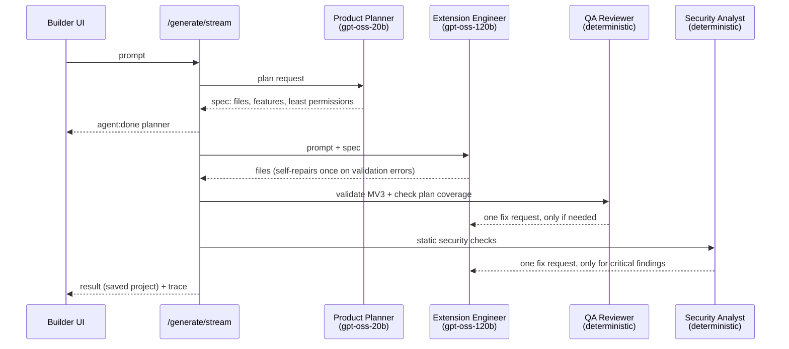

<div align="center">

# Extensio AI

### Describe a Chrome extension. Get a validated Manifest V3 project you can edit, review, audit and ship.

<br />

[](https://extension-ai-five.vercel.app/)
[](https://vercel.com/new/clone?repository-url=https://github.com/vardhan23v/extension-AI)

[](https://developer.chrome.com/docs/extensions/develop/migrate/what-is-mv3)
[](backend/tests)
[](LICENSE)

[](https://react.dev/)
[](https://vitejs.dev/)
[](https://tailwindcss.com/)
[](https://microsoft.github.io/monaco-editor/)

[](https://nodejs.org/)
[](https://expressjs.com/)
[](https://supabase.com/)
[](https://www.postgresql.org/)

[](#the-agent-crew)
[](https://groq.com/)
[](https://ai.google.dev/)
[](https://openrouter.ai/)

[](https://github.com/vardhan23v/extension-AI/commits/main)
[](https://github.com/vardhan23v/extension-AI/stargazers)
[](https://github.com/vardhan23v/extension-AI/issues)

[Live demo](https://extension-ai-five.vercel.app/) · [Architecture](#architecture) · [Quick start](#quick-start) · [API](#api-reference) · [Design system](DESIGN.md) · [Roadmap](EXTENSIO_UPGRADE_PLAN.md)

</div>

---

## Overview

Building a Chrome extension means learning Manifest V3, the permission model, service workers, content scripts and the store's security rules before writing any product code. Extensio AI removes that setup cost without hiding the code:

1. You describe the extension in plain English.
2. A crew of four agents plans it, writes it, checks it against Manifest V3 rules and reviews it for dangerous patterns, and you watch each step happen.
3. You get a real project in a browser IDE. Edit it by hand, or ask the assistant for changes and review a diff before anything is saved.
4. You run a security audit and download a ZIP that loads in `chrome://extensions`.

Generated code is treated as untrusted from start to finish. It is parsed, validated and audited, but never executed on the server.

## Features

| Area | What you get |
|---|---|
| **Generation** | Prompt → complete MV3 project (manifest, popup, service worker, content scripts, generated icons). Optional support link, webhook and `_locales` translations. |
| **Agent crew** | Product Planner (least-privilege spec) → Extension Engineer → QA Reviewer → Security Analyst, streamed live to the UI over Server-Sent Events. |
| **Validation** | MV3 schema, every referenced file, remote and inline scripts (blocked by MV3 CSP), host patterns, known permissions, JavaScript syntax. |
| **Code Studio** | Monaco editor bundled locally: file tree, tabs, search across files, autosave with retry, format, `manifest.json` schema diagnostics, Workbench light/dark themes. |
| **AI assistant** | Conversational edits and "fix this error" requests come back as a proposal with a per-file diff. Nothing changes until you apply it. Conversation history persists per project. |
| **History** | A snapshot is taken before every AI change, restore and burst of manual edits. Restore any version. |
| **Security Center** | Deterministic checks (broad host access, `eval`/`new Function`, unsafe DOM sinks, CSP, exposed keys, external messaging) plus an optional AI explanation. Results are reported as `passed`, `findings`, `incomplete` or `failed`. |
| **Preview** | Popup, options and side-panel pages rendered in a sandboxed iframe with simulated `chrome.*` APIs, in light and dark. |
| **Import** | Upload an existing extension ZIP (drag-and-drop) to edit, audit and publish it. Guarded against path traversal, zip bombs and tampered entries (CRC-checked). |
| **Publishing assistant** | Chrome Web Store readiness checklist computed from the code, AI-drafted listing (description, category, single purpose, per-permission justifications, privacy policy), promo tile, and a store package ZIP. You submit it yourself. |
| **Community** | Share projects, upvote (once per user) and clone. |

## Architecture



**Design decisions**

- **One deployable.** Vercel serves the static SPA and runs the Express app as a single serverless function (`vercel.json` rewrites `/api/*`). No separate backend host to keep alive.
- **Supabase for auth and data.** The browser handles sign-in with the public anon key. The API verifies the access token on every request and queries Postgres with the service-role key. Every query that touches user data filters by the authenticated user id. Row Level Security is enabled as a second layer.
- **Untrusted output by default.** AI-generated filenames and code go through a sanitizer (path traversal, file types, size limits) and a validator before they are stored. ZIPs are built in memory, with no temporary files.
- **Provider fallback.** `services/ai/providers.js` wraps Groq, Gemini and OpenRouter with timeouts, a retry that respects `Retry-After`, a JSON-mode fallback and per-request model overrides.

### The agent crew

Crew-style orchestration lives in the Node backend (`backend/services/crew`). It borrows CrewAI's ideas: agents with a role and a goal, a shared context and sequential hand-offs. It runs inside the existing serverless function, without a separate Python service.



- **Cost-aware.** Only the Planner and the Engineer always call a model. The Planner uses a smaller model, which on Groq has its own per-model rate limit. The reviewers are deterministic and call the Engineer only when they find a real problem.
- **Keep the fix only if it helps.** A fix is applied only if it does not make validation or security results worse.
- **Bounded.** The crew has a hard budget (`CREW_BUDGET_MS`, default 50 s) that keeps it inside Vercel's 60 s function limit. When time is short it skips optional steps and records the skip in the trace.
- **Fails safe.** If the Planner fails, the crew builds without a plan. If a reviewer fails, the valid result is kept. `CREW_ENABLED=false` switches back to the single-agent pipeline.

### Generation pipeline

```
model output ─▶ JSON extraction ─▶ manifest repair ─▶ filename sanitizer ─▶ icon injection ─▶ MV3 validator
                (fences, prose)    (JS-style /         (no ../, absolute    (real 16/48/128     (errors → one
                                    double-escaped)     paths, bad types)    PNGs)               repair attempt)
```

## Tech stack

| Layer | Choice | Why |
|---|---|---|
| Frontend | React 18, Vite 4, React Router 6, Tailwind 3 | Fast SPA, route-level code splitting |
| Editor | Monaco (bundled locally, workers via Vite) | VS Code editing model; no CDN dependency |
| Design | Tokens in CSS variables, Bricolage Grotesque / Geist / JetBrains Mono (self-hosted) | See [DESIGN.md](DESIGN.md) |
| API | Node.js, Express 4, helmet, express-rate-limit | Runs as one Vercel function |
| Data & auth | Supabase Postgres + Auth, RLS | Managed auth, SQL migrations, row-level security |
| AI | Groq (`openai/gpt-oss-120b`, `openai/gpt-oss-20b`), Gemini, OpenRouter | Fast primary, two fallbacks |
| Tests | Jest, Supertest | Route, service and crew tests with mocked providers |

## Repository layout

```
.
├── api/index.js                 # Vercel entry → backend/server.js
├── backend/
│   ├── server.js                # Express app: security headers, CORS, rate limits, error handling
│   ├── routes/ controllers/     # HTTP layer
│   ├── repositories/            # Supabase data access (owner-scoped)
│   ├── services/
│   │   ├── crew/                # Planner, Engineer, QA, Security agents + orchestrator
│   │   ├── ai/                  # Provider adapters and response parsing
│   │   ├── security/            # Static checks + audit status logic
│   │   ├── generation.service.js
│   │   ├── validator.service.js # Manifest V3 validator
│   │   ├── icons.service.js     # Dependency-free PNG icon generator
│   │   └── zipper.service.js    # In-memory ZIP
│   ├── utils/                   # Sanitizer, manifest repair, diff summary
│   └── tests/                   # Jest + Supertest
├── frontend/
│   └── src/
│       ├── components/ui/       # Design-system primitives
│       ├── features/            # workspace (Code Studio), crew, projects, security
│       ├── pages/               # Route-level screens (lazy-loaded)
│       └── lib/                 # API client (REST + SSE), preview builder, helpers
├── supabase/
│   ├── migrations/              # Applied in order (supabase db push)
│   └── rollbacks/               # Manual down migrations
├── DESIGN.md                    # Design system and motion rules
└── EXTENSIO_UPGRADE_PLAN.md     # Audit, phases and roadmap
```

## Quick start

**Prerequisites:** Node.js 18+, a [Supabase](https://supabase.com) project, and at least one AI key: [Groq](https://console.groq.com) (recommended), Gemini or OpenRouter.

```bash
git clone https://github.com/vardhan23v/extension-AI.git
cd extension-AI
npm run install:all
```

**1. Database:** apply the migrations with the Supabase CLI (or paste them into the SQL editor in order):

```bash
npx supabase@2 login
npx supabase@2 link --project-ref <your-project-ref>
npx supabase@2 db push
```

**2. Environment:** copy the examples and fill them in (details [below](#configuration)):

```bash
cp backend/.env.example backend/.env
cp frontend/.env.example frontend/.env.local
```

**3. Run:** API on `:5050`, app on `:5173`:

```bash
npm run dev:backend
npm run dev:frontend
```

Open http://localhost:5173 and create an account. If email confirmation is on in Supabase, confirm the email before signing in.

## Configuration

### Backend (`backend/.env`, server-only)

| Variable | Required | Default | Purpose |
|---|---|---|---|
| `SUPABASE_URL` | yes | | Project URL |
| `SUPABASE_SERVICE_ROLE_KEY` | yes | | **Secret** key (`sb_secret_…`). Never expose it to the browser. |
| `GROQ_API_KEY` / `GEMINI_API_KEY` / `OPENROUTER_API_KEY` | at least one | | Providers, tried in that order |
| `GROQ_MODEL` | | `openai/gpt-oss-120b` | Engineer model |
| `GROQ_FAST_MODEL` | | `openai/gpt-oss-20b` | Planner model |
| `CREW_ENABLED` | | `true` | `false` uses the single-agent pipeline |
| `CREW_BUDGET_MS` | | `50000` | Hard time budget for one crew run |
| `AI_TIMEOUT_MS` | | `90000` | Per provider request |
| `AI_RATE_LIMIT` | | `30` | AI requests per user per 15 minutes |
| `API_RATE_LIMIT` | | `120` | Requests per IP per minute |
| `CORS_ORIGINS` | prod | | Comma-separated allowed origins (localhost is allowed in development) |

### Frontend (`frontend/.env.local`, public, baked in at build time)

| Variable | Purpose |
|---|---|
| `VITE_SUPABASE_URL` | Project URL |
| `VITE_SUPABASE_ANON_KEY` | Publishable/anon key (safe to expose; protected by RLS and the API) |
| `VITE_API_URL` | API base in development (production uses same-origin `/api`) |

## Scripts

| Command | Where | Does |
|---|---|---|
| `npm run install:all` | root | Install backend and frontend dependencies |
| `npm run dev:backend` / `dev:frontend` | root | Run the API (nodemon) / Vite dev server |
| `npm test` | root or `backend/` | Jest suite (127 tests) |
| `npm run lint` | root or `frontend/` | ESLint |
| `npm run build` | root or `frontend/` | Production build to `frontend/dist` |
| `node backend/test-ai.js "<prompt>"` | | Live crew run against your real providers, printing each agent's timing (uses credits) |

## API reference

All routes are under `/api`. Authenticated routes need `Authorization: Bearer <Supabase access token>`. Ids are UUIDs. Errors return `{ message }`, plus `errors[]`/`warnings[]` for validation failures.

<details>
<summary><strong>Projects</strong></summary>

| Method | Path | Auth | Description |
|---|---|---|---|
| `POST` | `/extensions/generate` | ✓ | Run the crew and create a project → `{ extension, generation: { plan, trace, warnings } }` |
| `POST` | `/extensions/generate/stream` | ✓ | Same, as SSE: `agent:start`, `agent:done`, `result`, `error` |
| `GET` | `/extensions/my?q=&status=&limit=&offset=` | ✓ | List own projects (search, filter, paginate) |
| `GET` | `/extensions/:id` | ✓ | Project + current validation |
| `PATCH` | `/extensions/:id` | ✓ | Update `title`, `description`, `status` (`draft`/`ready`/`archived`) |
| `PUT` | `/extensions/:id/files` | ✓ | Save editor changes (sanitized, validated, snapshotted) |
| `POST` | `/extensions/:id/validate` | ✓ | Re-run the MV3 validator |
| `POST` | `/extensions/:id/duplicate` | ✓ | Copy a project |
| `DELETE` | `/extensions/:id` | ✓ | Delete a project and its history |
| `GET` | `/extensions/download/:id` | ✓ | ZIP download |
| `POST` | `/extensions/import` | ✓ | Import an extension; body is the raw ZIP (`Content-Type: application/zip`, ≤ 5 MB) |

</details>

<details>
<summary><strong>Assistant, history, audit</strong></summary>

| Method | Path | Auth | Description |
|---|---|---|---|
| `POST` | `/extensions/iterate/:id` | ✓ | Conversational edit; `{ prompt, preview: true }` returns a proposal without saving |
| `POST` | `/extensions/:id/debug` | ✓ | Fix from an error message; supports `preview` |
| `POST` | `/extensions/:id/apply` | ✓ | Apply a proposal (re-validated server-side) |
| `GET` | `/extensions/:id/messages` | ✓ | Assistant conversation |
| `GET` | `/extensions/:id/versions` | ✓ | Snapshots |
| `POST` | `/extensions/:id/versions/:versionId/restore` | ✓ | Restore a snapshot (the current state is snapshotted first) |
| `POST` | `/extensions/:id/audit` | ✓ | Security audit (owner only; result stored on the project) |
| `POST` | `/extensions/enhance-prompt` | ✓ | Expand a short idea into a detailed prompt |
| `GET` | `/extensions/:id/publishing` | ✓ | Store readiness checklist + saved listing |
| `POST` | `/extensions/:id/publishing/kit` | ✓ | Draft the listing with AI (saved, editable) |
| `PUT` | `/extensions/:id/publishing/kit` | ✓ | Save an edited listing |
| `GET` | `/extensions/:id/publishing/package` | ✓ | ZIP: `extension/` + `store-listing.md` + `privacy-policy.md` |

</details>

<details>
<summary><strong>Community, account, health</strong></summary>

| Method | Path | Auth | Description |
|---|---|---|---|
| `GET` | `/extensions/gallery` | | Public projects |
| `GET` | `/extensions/shared/:id` | | A public project |
| `POST` | `/extensions/:id/publish` | ✓ | Toggle public sharing |
| `POST` | `/extensions/:id/upvote` | ✓ | One vote per user (`409` on repeat) |
| `POST` | `/extensions/:id/clone` | ✓ | Clone a public project |
| `GET` / `PUT` | `/user/profile` | ✓ | Display name |
| `GET` | `/auth/me` | ✓ | Current user |
| `GET` | `/health` | | `{ status, database }` |

</details>

## Security model

- **Auth:** Supabase Auth in the browser. The API verifies every token server-side (`middleware/auth.middleware.js`). Hiding UI is never treated as authorization.
- **Data isolation:** every owner route filters by user id (`repositories/extensions.repo.js`). RLS policies in `supabase/migrations` block anon-key access to other users' rows.
- **Input:** UUID checks on route ids, length limits, https-only URLs for webhooks and support links, a 2 MB JSON body limit, rate limits on AI routes and all API routes.
- **Generated code:** sanitized filenames (60 files, 512 KB per file, 4 MB total), MV3 validation, static security checks. Code is never executed on the server; JavaScript is only parsed.
- **Preview isolation:** the preview runs in `sandbox="allow-scripts"` (opaque origin) with in-memory Chrome API mocks, so it can't reach the app's session or storage.
- **Honest reporting:** an audit is never reported as `passed` when the AI review could not run, and it is not a certification.
- **Headers & errors:** helmet, a CORS allowlist, and generic 5xx messages. Details go to server logs only, never secrets.

## Testing

```bash
npm test
```

The suite covers the sanitizer (traversal, absolute paths, NUL, size limits), the MV3 validator, the PNG and ZIP round-trip, manifest repair, provider fallback and retry, audit status logic, every route (auth, ownership, invalid ids, malformed AI output, rate limits, CORS, body limits), the Phase 2 workflows (save, preview/apply, versions, messages) and the crew (plan hand-off, fallback, single-fix rules, time budget, SSE stream). AI providers, Supabase and auth are mocked, so the suite runs offline.

## Deployment

The repo deploys to Vercel as-is (`vercel.json`):

- **Build:** `cd frontend && npm install && npm run build` → `frontend/dist`
- **Install:** `npm ci --prefix backend --omit=dev` (dependencies for the API function)
- **Routing:** `/api/*` → `api/index.js` (60 s max duration); everything else → SPA `index.html`

Set the backend variables and `VITE_SUPABASE_URL` / `VITE_SUPABASE_ANON_KEY` in the Vercel project, then push to `main`. In Supabase → Authentication → URL Configuration, set the Site URL to your production domain so confirmation emails link there.

## Limitations

- The preview is visual only. Content scripts and service workers don't run there; load the ZIP in Chrome to test behaviour.
- Security checks are automated pattern checks, not a review or Chrome Web Store approval.
- On free AI tiers, rate limits (for example Groq's tokens-per-minute) can make back-to-back generations wait or fail; the API reports this clearly.
- The Testing Lab (automated Chromium runs via GitHub Actions), bring-your-own AI keys, a visual theme editor and GitHub export are in progress. See the [roadmap](EXTENSIO_UPGRADE_PLAN.md).

## Contributing

Issues and pull requests are welcome. Before opening a PR:

```bash
npm test && npm run lint && npm run build
```

Keep UI changes consistent with [DESIGN.md](DESIGN.md), and add tests for any new route or service behaviour.

## License

[MIT](LICENSE)
